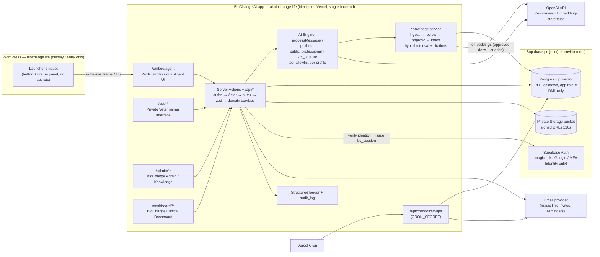

<div dir="rtl">

# BioChange MVP: אודיט לריפו, חילוץ MVP, אבטחה ותכנית פרודקשן

**סטטוס:** אודיט בלבד. לא שונה קוד, לא שונתה סכמה, לא בוצע deploy.
**ענף שנסרק:** `claude/lucid-babbage-qijzp7` (commit `ba613eb`, הענף היחיד בריפו).
**היקף הסריקה:** כל 114 הקבצים: `src/`, `db/migrations/`, `scripts/`, `tests/`, `README.md`, `docs/PRODUCT_SPEC_HE.md` ותצורות.
**מה לא נבדק בפועל:** לא הרצתי build/tests (אין `node_modules` ואין Postgres בסביבה). אין בריפו הוכחה שקיים deployment חי, ולכן כל מה שנאמר על Vercel/Supabase מבוסס על ה-README בלבד.

> **החלטות פתוחות שחוסמות חלק מהעבודה** מרוכזות בסעיף 13. הן מסומנות לאורך המסמך כ-❓.

---

## 0. תקציר מנהלים

1. **הריפו הוא מערכת אחת, בשלה ומתוכננת היטב:** Next.js 16 (App Router) עם backend משולב, Postgres + pgvector, סוכן OpenAI (Responses API + function calling) עם 32 כלים, RAG ממסמכים מאושרים עם ציטוטים, ניהול ידע עם workflow אישור, Cases + Follow-ups + מדידות, אחסון קבצים פרטי, audit log ו-RLS נעול. **כ-70% מתשתית ה-MVP כבר קיימת וניתנת למחזור כמעט כמו שהיא.**
2. **הארכיטקטורה כבר עונה על עקרון "אחד מכל דבר":** backend אחד, DB אחד, session layer אחד, authorization layer אחד (`Actor` + `authz.ts`), מנוע סוכן אחד (`processMessage`), גוף ידע אחד, storage אחד ו-audit log אחד. **חסר רק scheduler.**
3. **הפער האבטחתי המרכזי:** הבידוד הוא **ברמת מרפאה ולא ברמת וטרינר**. שני וטרינרים באותה מרפאה רואים זה את ה-Cases והקבצים של זה. הדבר סותר את הדרישה "וטרינר רואה רק את הנתונים שלו" (Critical, ראו S-01).
4. **פערים פונקציונליים עיקריים:**
   - אין Dashboard חוצה-מרפאות ל-BioChange.
   - אין scheduler או תזכורות (אין שליחת אימייל בכלל).
   - אין איסוף מובנה של product feedback ו-usability.
   - אין תמיכה בקובצי טיפול שאינם PDF.
   - אין סוכן ציבורי ללא התחברות.
   - אין התחברות ללא סיסמה (magic link או Google).
   - אין הגדרות "גבולות סוכן" שניתנות לניהול מה-Admin.
5. **פונקציונליות מתקדמת שאינה ב-MVP** (מלאי, הזמנות, adoption, הדרכה, clinic admin) **תישמר במלואה** ותנותק מה-production path באמצעות feature flags ו-tool allowlist לכל "פרופיל סוכן", בלי למחוק קוד או טבלאות.
6. **המלצת אינטגרציה ל-WordPress:** האפליקציה על **subdomain ייעודי תחת אותו דומיין** (למשל `ai.biochange.life`). ב-WordPress יושב רק launcher קטן שפותח iframe לנתיב `/embed` בדסקטופ, ומעבר לעמוד מלא במובייל. אין secrets ב-WordPress, אין CORS, וה-cookies עובדים כי זה same-site.
7. **המלצת Authentication לווטרינרים:** **Magic link (אימייל)** כשיטה ראשית, ו-Google Sign-In כאופציה. ההזמנה היא **invite-only**, והמימוש דרך ספק identity בשל (ההמלצה: Supabase Auth, שכבר נמצא בתכנון התשתית). הספק משמש רק לאימות הזהות, והוא ממופה לטבלת `users` ול-session layer הקיימים. לצוות BioChange: MFA חובה.

---

## 1. Current Architecture

### 1.1 Stack

| שכבה | מימוש קיים | קבצים |
|---|---|---|
| Frontend + Backend | Next.js 16 App Router, React 19, Server Components + Server Actions, Tailwind 4 | `src/app/**`, `src/components/**` |
| API routes | `POST /api/chat`, `GET /api/case-files/[id]`, `GET /api/knowledge-files/[id]` | `src/app/api/**` |
| Server Actions (mutations) | auth, account, cases, admin, commerce, chat | `src/app/actions/*.ts` |
| Domain services | כל שירות מקבל `Actor`, מאשר הרשאה וכותב audit | `src/server/domain/*.ts` |
| AI / Agent | OpenAI Responses API, `store:false`, function calling strict, עד 8 סבבי כלים, deadline של 100 שניות | `src/server/agent/*.ts`, `src/server/ai/openai.ts` |
| RAG | ingestion (PDF/TXT/MD/URL) → review → approve → semantic chunking → embeddings (`text-embedding-3-small`, 1536) → hybrid retrieval (vector + tsvector) עם authority ranking | `src/server/knowledge/*.ts` |
| DB | PostgreSQL 15+ עם pgvector, citext ו-pgcrypto. Driver: `postgres` (postgres.js) עם tagged templates (פרמטריזציה מלאה). אין ORM | `src/lib/db.ts`, `db/migrations/*.sql` |
| Migrations | SQL forward-only, טבלת `schema_migrations`, כל קובץ בטרנזקציה | `scripts/migrate.ts` |
| Auth | email + password (bcrypt 12), sessions אטומים ב-DB (SHA-256 של token), cookie `bc_session` httpOnly/Lax, lockout לפי email ו-IP | `src/lib/auth/*.ts`, `src/app/actions/auth.ts` |
| Authorization | `Actor {userId, role, clinicId}` נגזר מה-session בלבד. בדיקות `assertClinicRead/Write`, `assertKnowledgeManager`, `assertBioChangeAdmin` | `src/lib/authz.ts`, `src/lib/roles.ts` |
| Storage | driver `local` (dev) או `supabase` (bucket פרטי, signed URL ל-120 שניות). זיהוי סוג לפי magic bytes ושם אחסון אקראי | `src/lib/storage.ts` |
| Audit | טבלת `audit_log`. כל mutation, כולל ניסיונות כלים שנדחו | `src/lib/audit.ts` |
| Logging | `console.error` בלבד, לא מובנה | פזור |
| Scheduler / Jobs | **אין**. רק `after()` של Next.js להרצת extraction אחרי תשובה | `src/app/api/chat/route.ts` |
| Notifications | **אין** (אין email provider) | — |
| Deployment | README מתאר Vercel + Supabase. **אין** `vercel.json`, Dockerfile, CI או IaC בריפו | `README.md` |
| Tests | Vitest מול Postgres אמיתי: acceptance loop, safety/authz, chunking | `tests/*.ts` |

### 1.2 זרימת בקשה (צ'אט)

```
Browser ──POST /api/chat (same-origin check, session cookie, rate limit 40/10min, zod)──►
  processMessage(actor, channel, content)            ← src/server/agent/processMessage.ts
    ├─ getOrCreateConversation (scoped ל-user_id)
    ├─ buildContext: profile, memories, adoption, active case, inventory, pre-retrieval (4 passages)
    ├─ runAgent: Responses API loop → executeTool(name,args,state) → domain services (authz + audit)
    ├─ citations: רק תוויות [S#] שהתשובה ציטטה בפועל ושהוקצו בתור הזה
    ├─ persist assistant message + metadata (sources, tools, searches)
    └─ after(): runExtraction (classification + memories + knowledge gaps)
```

### 1.3 מודל הרשאות קיים

| Role | יכולות |
|---|---|
| `veterinarian` | צ'אט, Cases, מלאי והזמנות **של המרפאה שלו**, פרופיל, זיכרון, הדרכה, Medical Support |
| `clinic_admin` | זהה לווטרינר (אין הבדל בקוד) |
| `biochange_medical` | ניהול ידע, Claims, Gaps, Escalations. **לא** רואה Cases |
| `biochange_admin` | כל הנ"ל, ובנוסף Accounts, Products, Analytics (מצטבר), Audit log, וקריאת Case בודד לפי ID. **אין** רשימת Cases חוצת-מרפאות |

### 1.4 נקודות חוזק קיימות (לשמר)

- Authorization מבוסס `Actor` שנגזר מה-session ולעולם לא מה-client או מהמודל. הכלים של הסוכן עוברים דרך אותם domain services.
- הידע מופרד מההתנהגות: אין עובדות מוצר ב-system prompt, ויש לכך טסט.
- Governance של ידע:
  - מקור חדש נכנס כ-`pending_review` ולא נשלף עד שמאשרים אותו.
  - revoke ו-supersede מוחקים את ה-chunks.
  - עריכת טקסט מחזירה את המקור ל-review.
  - יש effective dates.
- ציטוטים מבוססי `[S#]`: רק מה שצוטט מוצג, ותוויות שהמודל המציא נזרקות.
- הגנת SSRF על ingestion מ-URL: allowlist של hosts, חסימת IP פרטיים ובדיקה בכל redirect.
- סוג קובץ נקבע לפי magic bytes, שם האחסון אקראי, והגשת קבצים מקומיים נעשית עם `CSP: sandbox`.
- RLS מופעל על כל הטבלאות **ללא policies**, ו-`anon`/`authenticated` מבוטלים. ה-REST API של Supabase לא חושף כלום.
- Fallback קבוע כשהמודל נכשל, בלי תוכן קליני.

---

## 2. Existing Capabilities That Can Be Reused

מקרא: ✅ מחזור כמו שהוא · 🔧 מחזור עם שינוי · ⏸ קיים אך מחוץ ל-MVP

### 2.1 Shared Backend

| יכולת | קבצים | סטטוס |
|---|---|---|
| Session layer + login lockout | `src/lib/auth/session.ts`, `login.ts`, `password.ts` | 🔧 נוסיף שיטת כניסה ללא סיסמה, idle timeout ו-MFA לצוות |
| Actor / authz | `src/lib/authz.ts`, `src/lib/roles.ts` | 🔧 נוסיף owner-scope לווטרינר והרשאת קריאה ל-BioChange User |
| DB pool + migrations | `src/lib/db.ts`, `scripts/migrate.ts` | ✅ |
| Env validation (zod) | `src/lib/env.ts` | 🔧 נוסיף `APP_ENV`, feature flags ו-secrets חדשים |
| Storage פרטי | `src/lib/storage.ts`, `src/app/api/*-files/[id]/route.ts` | 🔧 סוגי קבצים, EXIF, scan status ומחיקה |
| Audit log | `src/lib/audit.ts`, `audit_log` | 🔧 צמצום payload קליני, הוספת request id ו-IP |
| Error handling לפעולות | `src/lib/actions.ts` | ✅ |
| Same-origin guard | `src/lib/http.ts` | ✅ |
| RLS lockdown | `db/migrations/0002_row_level_security.sql` | ✅ |

### 2.2 BioChange Admin / Knowledge Management (ממשק 1)

| יכולת | קבצים | סטטוס |
|---|---|---|
| רשימת מקורות, סטטוס, chunk count ו-critical-docs panel | `src/app/(app)/admin/knowledge/page.tsx` | ✅ |
| העלאת PDF/TXT/MD או URL מאושר | `admin/knowledge/new`, `createSourceAction` | ✅ |
| Review של טקסט מחולץ ו-metadata (גרסה, מוצר, שוק, authority, תאריכים) | `admin/knowledge/[id]` | ✅ |
| Approve → index + embed, Revoke, Reparse | `src/server/knowledge/sources.ts` | 🔧 צריך index status מפורש ו-hard delete |
| העלאת גרסה חדשה (supersede) | `uploadSourceFileAction` | ✅ |
| Approved Claims | `admin/claims`, `src/server/knowledge/claims.ts` | ✅ |
| Knowledge Gaps | `admin/gaps`, `src/server/domain/gaps.ts` | 🔧 באג בשאלות בעברית (S-14) |
| Escalations (Medical Support) והמרה לידע | `admin/escalations`, `src/server/domain/escalations.ts` | ✅ משמש כ-escalation ב-MVP |
| Audit log viewer | `admin/audit` | ✅ |
| Accounts / clinics / users | `admin/accounts` | 🔧 מעבר ל-invite flow |
| **גבולות סוכן (allowed/disallowed topics, fallback, escalation contact)** | — | ❌ חסר |

> metadata קיימת: שם, גרסה, תאריך העלאה (`created_at`), מי העלה (`created_by`), סוג, `status` (active/inactive), `parse_status`/`parse_error`, `last_reviewed_at`/`reviewed_by`, effective dates ו-content hash.
> חסרים: `index_status`, `indexed_at`, `embedding_status` ו-`index_error`.

### 2.3 Professional Website Agent (ממשק 2)

| יכולת | קבצים | סטטוס |
|---|---|---|
| מנוע הסוכן, ערוץ-עצמאי | `processMessage.ts`, `loop.ts` | ✅ |
| System prompt עם גבולות קליניים (KNOWN, INTERPRETATION, UNKNOWN), ללא המצאות, escalation | `systemPrompt.ts` | 🔧 פיצול לפרופילים (public / vet-capture), הוצאת חלקי commerce/adoption, הזרקת גבולות שהוגדרו ב-Admin |
| RAG + ציטוטים + "View source" | `retrieve.ts`, `tools.ts` (`registerHits`), `src/app/(app)/sources/[id]` | ✅ |
| Knowledge gap logging + escalation | `gaps.ts`, `escalations.ts` | ✅ |
| Chat UI | `src/components/chat/*` | 🔧 גרסת `/embed` רזה |
| Rate limit למשתמש | `api/chat/route.ts` | 🔧 צריך rate limit לפי IP/אנונימי אם הסוכן ציבורי |
| **גישה אנונימית** | — | ❌ ❓ (ראו Q1) |

### 2.4 Private Veterinarian Clinical Data Capture (ממשק 3)

| יכולת | קבצים | סטטוס |
|---|---|---|
| Case CRUD, statuses (`discussion → planned → treated → follow_up_due → followed_up → closed`) | `src/server/domain/cases.ts`, `src/app/(app)/cases/**` | 🔧 owner scope |
| ראיון שיחתי שיוצר Case מובנה (`create_case`/`update_case` עם `user_confirmed`) | `tools.ts` | ✅ (עם allowlist כלים) |
| המשך Case: active case ו-`set_active_case`, קישור שיחות ל-Case | `tools.ts`, `case_conversations` | ✅ |
| מדידות baseline ו-follow-up בנפרד (longitudinal) | `case_measurements` | ✅ |
| Case notes | `case_notes` | ✅ |
| העלאת קבצים (radiograph, clinical_image, document) | `uploadCaseFileAction` | 🔧 treatment file, EXIF, scan |
| Follow-ups (scheduled, completed, cancelled) | `follow_ups` | 🔧 תזכורות |
| זיכרון וטרינר (scoped ל-user) | `memories`, `memory.ts` | ✅ |
| Extraction מובנה אחרי תשובה (`extracted_facts` pending) | `extraction.ts` | 🔧 ניתן להרחיב ל-feedback מובנה |
| **Product feedback / usability feedback מובנים** | — | ❌ |
| **Partial save / draft** | `status='discussion'` משמש כ-draft דה-פקטו | 🔧 |

### 2.5 BioChange Clinical Data Dashboard (ממשק 4)

| יכולת | קבצים | סטטוס |
|---|---|---|
| Analytics מצטבר (vets, questions, follow-ups, intents, top sources) | `admin/analytics`, `analytics.ts` | 🔧 ניתן להציג כ-KPI header בדשבורד |
| קריאת Case בודד ע"י admin | `assertClinicRead` | 🔧 |
| **רשימת וטרינרים/Cases חוצת-מרפאות, חיפוש, סינון, מיון, Case detail ל-BioChange, export** | — | ❌ |

---

## 3. Authentication Audit

### 3.1 מה קיים

| נושא | ממצא |
|---|---|
| Google login | **לא קיים** |
| OAuth / OIDC | **לא קיים** |
| Magic links | **לא קיים** |
| Email + password | **קיים.** bcrypt (12 rounds), מדיניות מינימלית (10 תווים, אותיות ומספרים) |
| Password reset / שינוי סיסמה | **לא קיים.** האדמין קובע סיסמה זמנית ואין חובה להחליף אותה |
| MFA | **לא קיים** |
| Roles | `veterinarian`, `clinic_admin`, `biochange_admin`, `biochange_medical` (CHECK constraint) |
| Session model | token אקראי של 32 bytes ב-cookie `bc_session`. ב-DB נשמר רק SHA-256. JOIN ל-`users.active` בכל בקשה |
| Cookie | `httpOnly`, `SameSite=Lax`, `path=/`, `Secure` רק כש-`NODE_ENV=production` |
| Expiration | מוחלט, `SESSION_TTL_HOURS=12`. **אין idle timeout ואין rotation/sliding** |
| Refresh tokens | אין (לא נדרש במודל server-side session) |
| Logout | מוחק את ה-session הנוכחי ואת ה-cookie, ונרשם audit. **אין "logout מכל המכשירים"** (מתבצע רק בעת השבתת משתמש) |
| CSRF | SameSite=Lax. Server Actions מקבלים בדיקת Origin מובנית של Next.js. `/api/chat` מוגן ב-`sameOrigin()` |
| Replay | session token אטום שנבדק מול ה-DB ונמחק ב-logout. אין replay של tokens חתומים. Magic links עתידיים יצטרכו one-time + TTL קצר |
| Brute force | נעילה אחרי 5 כישלונות ל-email או 20 ל-IP בחלון של 15 דקות, עם advisory lock נגד ניחושים מקבילים (נבדק בטסט). זמן תגובה אחיד ל-email לא קיים |
| Audit | `auth.login` ו-`auth.logout` נרשמים. **login failure לא נרשם ב-audit_log** (רק ב-`login_attempts`) |
| Session cleanup | אין job שמנקה sessions ו-login_attempts שפגו |

**הערכה:** ה-session layer עצמו בנוי נכון ומתאים לפרודקשן. החולשות הן:
- שיטת האימות: סיסמאות שאדמין מחלק ידנית, בלי reset ובלי MFA.
- חוסר MFA לצוות BioChange, שרואה את כל הדאטה הקליני.

### 3.2 המלצה: Authentication לווטרינרים

**מומלץ:** Magic link כשיטה ראשית, Google Sign-In כשיטה משנית אופציונלית. Invite-only.

**מימוש מומלץ (אחרי אישור):**

1. **ספק identity בשל:** Supabase Auth. הוא כבר חלק מהתכנון (Supabase ל-DB ול-Storage), תומך ב-magic link (OTP באימייל), Google OAuth עם PKCE, MFA (TOTP) ו-rate limiting על שליחת מיילים.
2. **הספק משמש לאימות זהות בלבד.** אחרי callback מוצלח בשרת, האפליקציה:
   - מאתרת את המשתמש ב-`users` לפי email מאומת (או לפי `auth_subject` שנשמר).
   - **מסרבת אם המשתמש לא הוזמן מראש או שאינו active** (invite-only, אין self-signup).
   - יוצרת את ה-`bc_session` הקיים.
   - כך ה-authorization layer, ה-`Actor` וכל ה-domain services לא משתנים.
3. לווטרינרים: ביטול הסיסמה (`password_hash = NULL`), כך שהם לא נחשפים לניהול סיסמאות.
4. **לצוות BioChange:** MFA חובה. אפשרות א': Google Workspace SSO, אם BioChange עובדת עם Google Workspace ❓ (מעביר את ה-MFA ל-Google). אפשרות ב': סיסמה + TOTP דרך Supabase MFA.
5. Sessions: הוספת idle timeout (למשל 30–60 דקות לצוות ו-12–24 שעות לווטרינר ❓), rotation בכניסה, `Secure` תמיד מחוץ ל-localhost, ו-"logout everywhere".

**חלופות שנבחנו:**

| חלופה | יתרון | חיסרון |
|---|---|---|
| Supabase Auth (מומלץ) | בשל, hosted, כבר בתוכנית התשתית, magic link + Google + MFA | שכבת session כפולה, שנפתרת ע"י שימוש בו רק לאימות ויציאה מיידית מה-Supabase session |
| Auth.js (NextAuth) עם Email + Google | ספרייה מוכרת, Postgres adapter | צריך לאמת תאימות ל-Next 16 ❓. מחליף או מקביל ל-session הקיים. מצריך email provider בכל מקרה |
| Magic link מותאם על ה-session הקיים | הכי מעט תלויות (~150 שורות + טבלת tokens) | זו authentication מותאמת אישית, בניגוד לעיקרון. צריך לממש בעצמנו one-time, TTL, rate limit ו-anti-enumeration |
| Clerk / Auth0 | בשל מאוד | ספק נוסף, עלות, מיפוי משתמשים ושליטה בדאטה מחוץ ל-Supabase |

> **בכל החלופות** נדרש email provider (Resend, Postmark או SES). אותו provider ישמש גם לתזכורות follow-up (סעיף 5).

---

## 4. Components Requiring Modification

| # | File / component | Current purpose | Required modification | Reason | Complexity | Security implications |
|---|---|---|---|---|---|---|
| M1 | `src/lib/authz.ts`, `src/server/domain/cases.ts` (`getCaseRow`, `searchCases`, `followUpsForClinic`), `today.ts`, `agent/context.ts` (follow-up counts), `inventory.ts` (case lookup), `api/case-files/[id]` | בידוד ברמת מרפאה | הוספת **owner scope**: וטרינר ניגש רק ל-Cases שבבעלותו (`owner_user_id = actor.userId`). BioChange User קורא הכל (read-only) | דרישת data isolation | M | **Critical.** סוגר IDOR/BOLA בין וטרינרים באותה מרפאה |
| M2 | `src/lib/roles.ts`, `authz.ts` | 4 roles | מיפוי MVP: `veterinarian`, ו-BioChange User = `biochange_admin` + `biochange_medical` (קריאת דשבורד). `clinic_admin` רדום | דרישת 2–3 roles | S | Authorization בשרת בלבד |
| M3 | `src/lib/auth/*`, `src/app/login/*`, `src/app/actions/auth.ts` | email + password | magic link / Google דרך ספק, invite-only, MFA לצוות, idle timeout, rotation, audit ל-login failure | אבטחה ו-UX | M–L | High |
| M4 | `src/server/agent/tools.ts`, `systemPrompt.ts`, `context.ts` | סוכן אחד עם 32 כלים ו-4 "תפקידים" | **Agent profiles:** `public_professional` (ידע + gap + escalation, בלי כלים שכותבים נתוני משתמש) ו-`vet_capture` (ידע + Cases + follow-up + feedback). Tool allowlist לכל פרופיל, ופרומפט שמתאים לכל פרופיל | ניתוק commerce/adoption בלי מחיקה, וצמצום attack surface | M | מקטין משמעותית את ההשפעה של prompt injection |
| M5 | `src/server/agent/loop.ts`, `context.ts` | `runtime_context` (כולל passages, memories ו-case notes) נשלח ב-role `developer` | העברת תוכן לא-אמין (passages, notes, memories, tool data) לבלוקי DATA מתוחמים ב-role נמוך יותר. השארת הוראות המערכת בלבד ב-developer | Prompt injection: תוכן לא-אמין מקבל כרגע עדיפות של developer | S–M | High |
| M6 | `src/lib/storage.ts`, `src/app/actions/cases.ts` (`uploadCaseFileAction`) | PDF, PNG, JPEG, WEBP, DICOM עד 20MB | הוספת `treatment_file` (PDF ו-CSV, אולי XLSX ❓); re-encode לתמונות (מסיר EXIF/GPS ומנטרל polyglots); `scan_status`; soft-delete + מחיקה מה-storage; rate limit להעלאות | העלאת קובץ טיפול; privacy | M | High |
| M7 | `src/server/knowledge/sources.ts`, admin knowledge pages | Revoke מסיר מה-retrieval, הקובץ והטקסט נשארים | הוספת `index_status`/`index_error`/`indexed_at`; התראה גלויה כשה-embedding נכשל; **Delete** אמיתי (מחיקת chunks, הקובץ ב-storage ו-`extracted_text`, עם רשומת audit) | "ingestion failure לא silent", "מחיקה מסירה באמת" | S–M | Medium |
| M8 | `src/server/domain/gaps.ts`, `escalations.ts` (`normalizeQuestion`), `memory.ts`, `retrieve.ts` (`toOrTsQuery`) | נרמול `[a-z0-9]` בלבד ו-`to_tsvector('english')` | תמיכה ב-Unicode (עברית): נרמול `\p{L}\p{N}`, ושימוש ב-config `simple` ל-keyword fallback | שאלה בעברית מתנרמלת למחרוזת ריקה, ה-gap לא נרשם, וה-keyword search לא עובד | S | Medium (silent failure) |
| M9 | `src/lib/audit.ts` וקריאות `audit()` ב-`cases.ts`, `memory.ts`, `escalations.ts` | `inputSummary` כולל תוכן קליני מלא (notes, case summary, שאלות ותשובות) | רישום שמות שדות ו-IDs בלבד, ללא ערכים קליניים | Data minimization בלוגים | S | Medium |
| M10 | כל `console.error(err)` (כ-20 מקומות) | Logging לא מובנה | Logger מובנה (JSON) עם redaction. אין להדפיס אובייקטי `PostgresError`, שכוללים `parameters` (כלומר ערכים קליניים) | Logging | S–M | Medium |
| M11 | `next.config.ts` | `X-Frame-Options: DENY` גלובלי, HSTS, nosniff, בלי CSP לעמודים | CSP לכל האפליקציה. `frame-ancestors` מוגבל ל-origins של WordPress **רק** ב-`/embed/*`, ו-DENY בכל השאר. הקטנת `serverActions.bodySizeLimit` | WordPress embed + XSS defence-in-depth | S | Medium |
| M12 | `src/lib/env.ts`, `.env.example` | env אחד | `APP_ENV` (development/staging/production), `FEATURES`, secrets ל-auth/email/cron, `ALLOWED_EMBED_ORIGINS` | Environment separation | S | Medium |
| M13 | `src/server/domain/cases.ts` (`scheduleFollowUp`, `createCase`) | follow-up רק בתאריך שהווטרינר בחר | ברירת מחדל: `treatment_date + follow_up_default_days` (90, ניתן להגדרה). מניעת כפילויות ע"י unique partial index | Follow-up system | S | Low |
| M14 | `src/app/(app)/layout.tsx`, `Sidebar.tsx`, דפי inventory/orders/education | ניווט לכל היכולות | הסתרה וחסימה (route guard עם `notFound()`) לפי feature flags | ניתוק out-of-scope | S | Low |
| M15 | DB connection (`DATABASE_URL`) | חיבור כבעלים של הטבלאות (עוקף RLS) | Role נפרד לאפליקציה עם DML בלבד (בלי DDL), ו-role נפרד ל-migrations | Least privilege | S | Medium |
| M16 | `admin/accounts` + `createUserAction` | אדמין קובע סיסמה | Invite flow: יצירת משתמש בלי סיסמה, ושליחת קישור הזמנה | Auth | S | Medium |
| M17 | `get_case` tool (`tools.ts`) | מחזיר למודל שמות קבצים ותיאורים | השמטת `file_name` (עלול להכיל שם בעלים או מטופל) | Privacy | XS | Low |

---

## 5. Missing Functionality

| # | חסר | ממשק | הערות |
|---|---|---|---|
| F1 | Scheduler (cron) | Follow-up | אין בכלל. מומלץ Vercel Cron → `POST /api/cron/follow-ups` מוגן ב-`CRON_SECRET`. חלופה: Supabase `pg_cron` |
| F2 | שליחת אימייל (תזכורות + magic link + invites) | משותף | אין provider. נדרשת טבלת outbox לאמינות ולמניעת כפילויות |
| F3 | Reminder lifecycle (status, sent_at, attempts, dedupe) | Follow-up | הסכמה של `follow_ups` לא כוללת שדות תזכורת |
| F4 | ברירת מחדל של 3 חודשים, ניתנת לשינוי | Follow-up | נדרשת טבלת `app_settings` |
| F5 | Product feedback + ease-of-use feedback מובנים | Clinical capture | טבלה חדשה (`case_feedback`) + כלי סוכן + טופס |
| F6 | Treatment file upload (פורמטים של מערכות ניהול מרפאה) | Clinical capture | ❓ אילו פורמטים |
| F7 | BioChange Dashboard: רשימת וטרינרים ו-Cases חוצת-מרפאות, חיפוש, סינון, מיון, Case detail (read-only), אינדיקציה ל-follow-up חסר, last activity | Dashboard | חדש. ממחזר את `CASE_SELECT` ואת דפי ה-Case |
| F8 | Export (CSV/Excel/research dataset) | Dashboard | שלב ראשון: CSV מצד השרת, עם audit. Excel/de-identified dataset בהמשך |
| F9 | הגדרות "גבולות סוכן" ב-Admin (allowed/disallowed topics, fallback text, escalation contact, product scope) | Admin | טבלת `agent_policy`. מוזרקת לפרומפט כ-policy, ולא חושפת את ה-system prompt עצמו |
| F10 | סוכן ציבורי ללא התחברות ❓ | Website agent | מצריך anonymous session, rate limit לפי IP, bot protection (Turnstile), מגבלת עלות יומית ו-retention קצר |
| F11 | `/embed` route + WordPress launcher | WordPress | חדש |
| F12 | Magic link / Google / MFA / invite | Auth | ראו סעיף 3 |
| F13 | Health endpoint (`/api/health`: DB + storage + config, ללא secrets) | Ops | חסר |
| F14 | Structured logging + error monitoring (Sentry או log drain) | Ops | חסר |
| F15 | CI (typecheck, build, tests מול Postgres+pgvector, migrations dry-run) | Ops | אין `.github/` |
| F16 | Global rate limiting (uploads, server actions, anonymous chat) | API | קיים רק ל-login ול-chat |
| F17 | Malware scanning | Uploads | מומלץ שירות חיצוני. ב-MVP: re-encode לתמונות, ו-PDF מוגש רק כהורדה או ב-sandbox |
| F18 | Retention/deletion policies (מחיקת Case, קבצים, שיחות) | Privacy | אין מחיקה בכלל לנתוני וטרינר |
| F19 | Session/login_attempts cleanup job | Auth | יוסיף ל-F1 |
| F20 | Admin audit trail viewer עם סינון לפי action | Admin | קיים בסיסי. לוודא שכל פעולות ה-Admin נרשמות, כולל `agent_policy` |

---

## 6. Out-of-Scope Existing Functionality

**עיקרון:** לא מוחקים קוד, טבלאות או טסטים. מנתקים ב-3 שכבות:
- **Feature flags בשרת:** משתנה `FEATURES`, ש-`env.ts` מאמת.
- **Tool allowlist לכל agent profile.**
- **Route guards:** `notFound()` ב-layout של כל אזור כבוי, והסתרה ב-Sidebar.

ה-DB נשאר שלם, כך שהפעלה מחדש היא שינוי config בלבד.

| יכולת | קבצים | ניתוק בטוח |
|---|---|---|
| מלאי (confirmed/estimated, forecast, low-stock cards) | `domain/inventory.ts`, `(app)/inventory`, כלים: `get_inventory`, `set_inventory_confirmed`, `record_product_usage`, `estimate_inventory` | flag `inventory=off`: הסרה מה-allowlist, דילוג על בלוק המלאי ב-`buildContext` ועל הכרטיסים ב-`getTodayCards`, route guard |
| הזמנות (draft, confirm, status) | `domain/orders.ts`, `actions/commerce.ts`, `actions/chat.ts`, `(app)/orders`, כלים: `get_order_history`, `prepare_order`, `confirm_order_record`, `update_order_status` | flag `orders=off`. ב-`confirmOrderFromChat` מוסיפים guard בשרת (לא רק הסתרת UI) |
| Adoption journey | `domain/adoption.ts`, `adoption_states`, כלים: `get_adoption_state`, `update_adoption_state`, `ADOPTION_HINTS` בקונטקסט | flag `adoption=off`. `recomputeAdoption` יכול להמשיך לרוץ ברקע (לא מזיק), או ש-no-op תחת flag |
| הדרכה / Education | `domain/education.ts`, `(app)/education`, כלים: `search_training_material`, `record_training_activity` | flag `education=off` |
| Clinic Admin role | `roles.ts` | לא מקצים את התפקיד ב-MVP. הקוד נשאר |
| Distributors | טבלת `distributors`, `get_clinic` | נשאר בסכמה, ומוסר מה-allowlist |
| Multi-channel (WhatsApp וכו') | `Channel` ב-`processMessage.ts` | כבר לא ממומש, רק type. נשאר |
| Analytics של adoption/commerce | `domain/analytics.ts` | נשאר בעמוד Analytics. חלקים רלוונטיים ימוחזרו לדשבורד |
| Pre-retrieval/extraction | `extraction.ts` | **נשאר ב-MVP** (classification ו-gaps), אבל הכתיבה ל-memory רק בפרופיל `vet_capture` |
| Approved Claims, Evidence studies | `claims.ts`, `evidence_studies` | **נשאר ב-MVP** כחלק מגוף הידע |

**רשימה סופית** של מה שנשמר ומה שנוטרל תתועד ב-`docs/PRESERVED_FUNCTIONALITY.md` (תוצר 20) בשלב ה-implementation.

---

## 7. Proposed MVP Architecture

</div>



<div dir="rtl">

**עקרונות:**
- **מקור אמת יחיד להרשאות:** `Actor` שנגזר מ-`bc_session`. WordPress, iframe ו-frontend לא מעבירים הרשאות.
- **ארבעת הממשקים הם route groups באותה אפליקציה**, על אותו backend, DB, storage ומנוע. ניתן להפריד בעתיד ל-subdomain (`vet.`, `admin.`) בלי שינוי backend.
- **קובצי טיפול ותמונות לא נשלחים ל-OpenAI, ל-embeddings או ל-analytics.** זה כבר המצב היום, ונשמר כ-invariant עם טסט.

---

## 8. Proposed Data Model

### 8.1 מיפוי ישויות מבוקשות לסכמה קיימת

| Entity מבוקש | קיים? | טבלה קיימת | שינוי מוצע |
|---|---|---|---|
| User | ✅ | `users` | `auth_provider`, `auth_subject` (unique), `invited_at`, `mfa_required`. `password_hash` כבר nullable |
| Veterinarian | ✅ | `users(role='veterinarian')` + `veterinarian_profiles` | ללא שינוי |
| BioChangeUser | ✅ | `users(role IN ('biochange_admin','biochange_medical'))` | אופציונלי: role `biochange_viewer` (read-only לדשבורד) ❓ |
| Clinic | ✅ | `clinics` | ללא שינוי |
| Case | ✅ | `cases` | **`owner_user_id uuid NOT NULL`** (backfill מ-`created_by`), `last_activity_at`, אינדקס `(owner_user_id, updated_at)` |
| Treatment | 🔶 חלקי | שדות ב-`cases` (product_id, variant, treatment_date, procedure_type) + `inventory_events(usage, case_id)` | ❓ אם צריך כמה טיפולים או מוצרים לכל Case: טבלת `case_treatments` (case_id, product_id, variant, units_used, treatment_date, procedure details). אחרת, השדות הקיימים מספיקים ל-MVP |
| FollowUp | ✅ | `follow_ups` + `case_measurements` | `kind` ('scheduled'/'default_3m'), `reminder_status` ('pending','sent','failed','skipped'), `reminder_sent_at`, `reminder_attempts`, unique partial index `(case_id, kind) WHERE status='scheduled'` |
| Feedback | ❌ | — | **`case_feedback`**: case_id, author_id, product_id, `product_rating`, `ease_of_use_rating`, `handling_issues`, `would_use_again`, free text, `phase` ('treatment'/'follow_up'), created_at |
| Conversation | ✅ | `conversations`, `messages`, `case_conversations` | `agent_profile` ('public_professional'/'vet_capture'), `anonymous_session_id` (אם Q1=כן) |
| KnowledgeDocument | ✅ | `knowledge_sources`, `knowledge_chunks`, `evidence_studies`, `approved_claims` | `index_status`, `index_error`, `indexed_at`, `deleted_at` |
| UploadedFile | ✅ | `case_files` | `file_type` + 'treatment_file', `sha256`, `scan_status`, `deleted_at` |
| Product | ✅ | `products` | ללא שינוי |
| AuditLog | ✅ | `audit_log` | `request_id`, `ip` (אופציונלי) |
| AppSettings | ❌ | — | `app_settings(key, value jsonb, updated_by, updated_at)`, למשל `follow_up_default_days=90` |
| AgentPolicy | ❌ | — | `agent_policy`: allowed_topics, disallowed_topics, fallback_text, escalation_contact, product_scope, version, updated_by |
| Notification/Outbox | ❌ | — | `notification_outbox(id, kind, user_id, follow_up_id, dedupe_key UNIQUE, status, attempts, sent_at)` |
| Memory | ✅ | `memories` | ללא שינוי (scoped ל-user_id) |

### 8.2 עקרונות

- **Expand/contract migrations בלבד:** מוסיפים עמודות nullable, עושים backfill, ורק אז מוסיפים NOT NULL. אין DROP, כך שה-rollback של הקוד בטוח.
- **מידע קליני משמעותי נשמר מובנה:** cases, measurements, feedback ו-treatments, לא רק ב-transcript. `extracted_facts` משמש כתור הצעות שהווטרינר מאשר.
- **מוכנות ל-research:** כל עמודה קלינית typed. export דרך view ייעודי עם אפשרות de-identification (בלי `internal_patient_identifier` ובלי free text).

---

## 9. Security Audit

### 9.1 ממצאים

| ID | חומרה | תחום | ממצא | המלצה |
|---|---|---|---|---|
| S-01 | **Critical** | Authorization / IDOR-BOLA | בידוד ברמת מרפאה: `assertClinicRead/Write` משווים `clinicId` בלבד. וטרינר A ניגש ל-Cases, קבצים (`/api/case-files/[id]`), follow-ups ו-notes של וטרינר B **באותה מרפאה**, גם דרך כלי הסוכן (`get_case`, `search_cases`) | Owner scope (M1) + טסטים. ❓ אם שיתוף בתוך מרפאה רצוי, יש לתעד זאת כהחלטה (ואז החומרה יורדת) |
| S-02 | **Critical** (go-live blocker, תוכן) | RAG | אין IFU, רגולציה או פרוטוקולים מאושרים. מקורות `demo-mock` נועדו לדמו בלבד | יש לבטל את `demo-mock` ואת חשבונות הדמו לפני production, ולהוסיף טסט/בדיקת startup ב-production שמסרבת אם קיימים |
| S-03 | **High** | Authentication | אין MFA לצוות BioChange שרואה את כל הדאטה. סיסמאות זמניות מחולקות ידנית, ללא חובת החלפה וללא reset | סעיף 3.2 |
| S-04 | **High** | Prompt injection | `runtime_context`, שכולל passages ממסמכים, case notes ו-memories (תוכן לא-אמין), נשלח ב-role `developer`, כלומר עם עדיפות גבוהה מהמשתמש. יש הגנה בפרומפט בלבד | M5. בנוסף: tool allowlist לכל פרופיל (M4), אישור UI לפעולות הרסניות (close/cancel), ו-eval suite של injection |
| S-05 | **High** | File upload | אין הסרת EXIF/GPS מתמונות, אין malware scan, אין מחיקה. PDF מוגש `inline` (בסביבת Supabase דרך redirect לדומיין storage) | M6, F17. תמונות עוברות re-encode. `Content-Disposition: attachment` ל-PDF/DICOM |
| S-06 | **High** | Data to 3rd party | כל תוכן הצ'אט, הקונטקסט (Case, memories) ושאילתות ה-embeddings נשלחים ל-OpenAI (`store:false`) | DPA + Zero Data Retention מול OpenAI, החלטת data residency ❓. קבצים לא נשלחים (נשמר). להנחות את הווטרינר לא לכלול מזהים |
| S-07 | **Medium** | Logging | `console.error(err)` עם `PostgresError` מדפיס `parameters`, כלומר ערכים קליניים. אין redaction | M10 |
| S-08 | **Medium** | Audit minimization | `audit_log.input_summary` שומר note מלא, case summary, שאלות ל-Medical Support ותשובות | M9 |
| S-09 | **Medium** | DB least privilege | האפליקציה מתחברת כבעלים (DDL, עוקף RLS). Storage עם `SUPABASE_SERVICE_ROLE_KEY` (מפתח על) | M15. Storage: מפתח service נשאר בשרת בלבד (כך היום). לשקול policy מצומצם ל-bucket |
| S-10 | **Medium** | Rate limiting / abuse | אין rate limit על uploads, server actions ו-admin. `bodySizeLimit=20mb` לכל server action. אין bot protection | F16. WAF/Upstash או Postgres-based limiter. Turnstile לסוכן הציבורי |
| S-11 | **Medium** | CSP / Headers | אין CSP לעמודי האפליקציה (קיים רק להגשת קבצים). `X-Frame-Options: DENY` גלובלי מתנגש עם embed | M11. CSP עם nonce, ו-`frame-ancestors` רק ל-`/embed` |
| S-12 | **Medium** | Environment separation | אין `APP_ENV`. אותו קוד מסתמך על `NODE_ENV`. אין הגנה מפני חיבור staging ל-DB של production | M12. פרויקט Supabase נפרד לכל סביבה, secrets נפרדים, ובדיקת startup שה-host של ה-DB תואם לסביבה |
| S-13 | **Medium** | Agent actions | פעולות כמו `close_case`, `update_order_status(cancelled)` ו-`set_inventory_confirmed` מתבצעות מהצ'אט בלי לחיצת אישור (החלטה פתוחה במסמך האפיון) | ב-MVP: `close_case` דורש אישור UI כמו הזמנות. כלי commerce כבויים ממילא |
| S-14 | **Medium** | Functional/safety | שאלות בעברית: `normalizeQuestion` מחזיר `""`, כך שה-gap לא נרשם בשקט. keyword search מתעלם מעברית. dedupe של memories לא עובד | M8 |
| S-15 | **Medium** | Ops | אין health endpoint, monitoring, CI, backup policy מתועדת או rollback procedure | F13–F15, סעיף 10 |
| S-16 | **Medium** | Privacy | אין מחיקה או retention לנתוני וטרינר (Case, קבצים, שיחות). Revoke של מסמך ידע משאיר את הקובץ ואת `extracted_text` | F18, M7 |
| S-17 | **Low** | Session | אין idle timeout ואין rotation. `Secure` תלוי ב-`NODE_ENV`. אין "logout everywhere". אין cleanup לרשומות שפגו | סעיף 3.2 |
| S-18 | **Low** | Auth | Lockout לפי email מאפשר נעילה זדונית של וטרינר מסוים (DoS ממוקד). login failure לא נרשם ב-audit | Magic link מבטל את הבעיה. רישום audit |
| S-19 | **Low** | CSRF | `sameOrigin()` סומך על `x-forwarded-host`. בטוח מאחורי Vercel, אבל תלוי-פלטפורמה | השוואה ל-`APP_URL` מוגדר |
| S-20 | **Low** | Privacy | `get_case` שולח למודל שמות קבצים | M17 |
| S-21 | **Low** | Headers | HSTS עם `preload` על subdomain חסר משמעות. `includeSubDomains` ישפיע רק על תתי-הדומיין של האפליקציה | התאמה בעת קביעת הדומיין |

### 9.2 בדיקות שעברו (אין ממצא)

| תחום | מצב |
|---|---|
| SQL injection | כל השאילתות ב-tagged templates של postgres.js (פרמטריזציה). `sql.unsafe` רק ב-migrations מקבצים מקומיים. `to_tsquery` מקבל רק `[a-z0-9]` |
| Secrets ב-frontend | אין `NEXT_PUBLIC_*`. `server-only` מיובא בכל מודול רגיש. `.env` ב-`.gitignore`. `.env.example` ללא ערכים אמיתיים |
| User ID מה-client | לא קיים. כל הפעולות גוזרות `Actor` מה-session. ה-`conversationId` נבדק מול `user_id` |
| Direct URL / manipulated IDs | דפי Case, קבצים ושיחות בודקים הרשאה בשרת ומחזירים 404 (פרט ל-S-01 בתוך מרפאה). דפי Admin מוגנים ב-layout ושוב ב-domain service |
| Supabase public API | RLS ללא policies + REVOKE מ-anon/authenticated |
| SSRF ב-ingestion | allowlist, https בלבד, חסימת IP פרטיים, בדיקה בכל hop |
| Path traversal | שמות אחסון אקראיים. `localPath()` מוודא שהנתיב נשאר תחת root. שם הקובץ המקורי עובר sanitize ונשמר כ-metadata בלבד |
| File type spoofing | magic bytes, לא extension או MIME מה-client |
| XSS בתשובות | Markdown renderer ללא HTML passthrough. אין `dangerouslySetInnerHTML` |
| RAG isolation | רק `status='approved'`, לא placeholder, בטווח effective dates. revoke/supersede מוחקים chunks. עריכת טקסט מחזירה ל-review ומוחקת chunks. אין "customers" מרובים, כך ש-cross-customer leakage לא רלוונטי (DB אחד לכל סביבה) |
| CORS | אין headers של CORS, כלומר same-origin בלבד כברירת מחדל. זה הרצוי. ארכיטקטורת ה-subdomain לא מחייבת CORS |

---

## 10. Deployment Plan

**ממצא:** אין תשתית deployment בריפו. ה-README מתכנן **Vercel + Supabase**. ממליץ להישאר עם התכנון הזה: הוא מתאים ל-Next.js ולשימוש הקיים ב-pgvector וב-Supabase Storage, ואין סיבה לעבור ספק. ❓ יש לאשר שהחשבונות קיימים או שיפתחו על שם BioChange.

| דרישה | מימוש מוצע |
|---|---|
| Reproducible build | `package-lock.json` קיים. `npm ci` + `next build` ב-CI. Node 22 מוצמד (`engines`) |
| Environments | Vercel: Production, Preview (= staging) ו-Development. **שני פרויקטי Supabase נפרדים** (staging, production). Preview deployments מחוברים ל-staging בלבד |
| Secrets | Vercel Environment Variables, מופרדים לפי סביבה. אין secrets משותפים. `.env.example` עם שמות בלבד |
| Migrations | GitHub Actions: job ידני/מאושר מריץ `db:migrate` מול staging, ואחר כך production, לפני promote. Expand/contract בלבד |
| Persistent DB | Supabase Postgres (אזור ❓ EU) |
| File storage | Supabase Storage, bucket פרטי `private-files`, encryption at rest (ברירת מחדל של Supabase) |
| HTTPS | Vercel (TLS אוטומטי) + HSTS |
| Encryption at rest | Supabase: DB, backups ו-storage מוצפנים at rest כברירת מחדל ❓ לאמת בתוכנית שתיבחר |
| Restart / recovery | Serverless (Vercel). ה-DB מנוהל |
| Logging | Logger מובנה ל-stdout, Vercel Log Drain ליעד שנבחר ❓ |
| Monitoring / errors | Sentry (server + client, עם `beforeSend` redaction) או חלופה ❓. Uptime check על `/api/health` |
| Health endpoint | `/api/health`: בודק DB ו-config, בלי פרטים פנימיים |
| Rate limiting | Postgres-based (הדפוס הקיים) ל-MVP, או Upstash Redis. Vercel Firewall rules |
| Scheduler | Vercel Cron (יומי) → `/api/cron/follow-ups` עם `Authorization: Bearer CRON_SECRET` |
| Backups | Supabase daily backups. **PITR מומלץ** (תוסף בתשלום). בדיקת restore רבעונית |
| Rollback | קוד: Vercel Instant Rollback. DB: migrations תואמות-לאחור (expand/contract), כך שקוד ישן עובד עם סכמה חדשה. אין down-migrations, ולכן fix-forward |
| Function duration | `maxDuration=120` ב-`/api/chat` מחייב Vercel Pro ❓ |
| Least privilege | Role `app_rw` (DML) ל-`DATABASE_URL`, ו-role `migrator` ל-CI בלבד |

---

## 11. WordPress Integration Plan

### 11.1 השוואת חלופות

| חלופה | Auth/Session | Mobile | CORS/CSP | אבטחה | תחזוקה | הערכה |
|---|---|---|---|---|---|---|
| iframe ל-**דומיין אחר** | cookies צד שלישי חסומים (Safari/Chrome), כך שהתחברות בתוך iframe נשברת | בינוני | frame-ancestors | טוב | טוב | ❌ |
| JS widget שמרנדר בתוך DOM של WordPress | מצריך CORS + credentials או tokens בדפדפן. WordPress plugins/CSS מתנגשים | בינוני | CORS עם credentials | חלש: חולק DOM עם WordPress ותוספים | חלש | ❌ |
| לוגיקת סוכן בתוך WordPress (plugin PHP) | secrets ב-WordPress | — | — | חלש | חלש | ❌ |
| Route ייעודי בתוך WordPress (reverse proxy `/ai/*`) | same-origin | טוב | פשוט | בינוני: תלוי בתצורת ה-proxy/CDN, וה-cache עלול לשמור תוכן פרטי | מורכב | ⚠️ |
| **Subdomain ייעודי + launcher** | **same-site**: cookie `SameSite=Lax` נשלח גם בתוך iframe מאותו registrable domain. אין צורך ב-third-party cookies | iframe panel בדסקטופ, עמוד מלא במובייל | אין CORS. `frame-ancestors` רק ל-`/embed` | חזק: הפרדה מלאה. WordPress מחזיק רק snippet | פשוט | ✅ **מומלץ** |

### 11.2 ההמלצה

1. האפליקציה רצה על `ai.biochange.life` (שם סופי ❓) כ-CNAME ל-Vercel.
2. ב-WordPress מוסיפים **snippet אחד** (או custom HTML block / plugin קוד קצר):
   - כפתור צף "Ask BioChange AI".
   - **בדסקטופ:** פותח panel עם `<iframe src="https://ai.biochange.life/embed/agent" sandbox="allow-scripts allow-same-origin allow-forms allow-popups">`.
   - **במובייל** (או כשה-iframe נחסם): ניווט ל-`https://ai.biochange.life/agent`.
3. אין secrets, API keys או לוגיקה ב-WordPress. WordPress **לא** מעביר זהות. התחברות, אם נדרשת, מתבצעת באפליקציה עצמה.
4. בצד האפליקציה:
   - `/embed/*` מקבל `Content-Security-Policy: frame-ancestors https://biochange.life https://www.biochange.life`.
   - שאר האתר: `frame-ancestors 'none'`.
   - `Cache-Control: private, no-store` לכל תוכן מאומת.
   - ה-CDN של WordPress לא נוגע באפליקציה, כי זה host נפרד.
5. **הממשק הפרטי לווטרינרים, Admin ו-Dashboard לא מוטמעים ב-iframe.** הם נגישים ישירות (`ai.biochange.life/vet`, `/admin`, `/dashboard`) ובעתיד ניתנים להפרדה ל-subdomains.
6. **תנאי:** ה-WordPress וה-subdomain תחת אותו registrable domain. ❓ לאמת את הדומיין וגישה ל-DNS. אם ה-WordPress על דומיין אחר, החלופה היא launcher שפותח חלון או טאב חדש במקום iframe.

---

## 12. Implementation Plan

הסדר שונה מעט מההצעה: Auth ו-data model לפני הממשקים, כי כל הממשקים תלויים בהם.

### Phase 0: החלטות (חוסם)
מענה לשאלות בסעיף 13: Q1 (ציבורי/מחובר), Q2 (שיתוף בתוך מרפאה), Q3 (תשתית), Q4 (דומיין), Q6 (פורמטים).

### Phase 1: Security-critical fixes והכנת ארכיטקטורה
- M1 owner scope + טסטי IDOR (S-01).
- M5 העברת תוכן לא-אמין מ-developer role (S-04).
- M9/M10 redaction בלוגים וב-audit (S-07, S-08).
- M11 CSP + headers. M12 `APP_ENV` + feature flags. M15 DB role.
- M8 תמיכה בעברית.
- CI בסיסי (typecheck, build, tests).
- **תוצרים:** `.env.example` מעודכן, `SECURITY.md` (טיוטה).

### Phase 2: Shared backend ו-data model
- Migrations (expand-only):
  - `cases.owner_user_id`
  - `case_feedback`
  - שדות reminder ב-`follow_ups` + unique index
  - `app_settings`, `agent_policy`, `notification_outbox`
  - `case_files` (treatment_file, sha256, scan_status, deleted_at)
  - `knowledge_sources` (index_status...)
  - `users` (auth_subject...)
- Feature flags וניתוק out-of-scope (סעיף 6). Agent profiles + tool allowlist (M4).

### Phase 3: Authentication
- ספק identity (magic link + Google), invite-only, MFA לצוות, idle timeout, audit ל-login failure, email provider.

### Phase 4: Knowledge/Admin interface
- index status גלוי, Delete אמיתי, מסך `agent_policy` (גבולות הסוכן), invite flow ב-Accounts.

### Phase 5: Professional website agent
- פרופיל `public_professional`, `/embed/agent` UI רזה, rate limit + Turnstile (אם ציבורי), evals ל-injection, out-of-scope ו-unknown.

### Phase 6: Veterinarian clinical-data flow
- פרופיל `vet_capture`: ראיון שמילא Case + feedback מובנה, partial save, העלאות (treatment file + re-encode תמונות), resume.

### Phase 7: BioChange dashboard
- רשימות וטרינרים ו-Cases, חיפוש, סינון ומיון, Case detail read-only, אינדיקציה ל-follow-up חסר, export CSV עם audit.

### Phase 8: Follow-up system
- ברירת מחדל של 90 יום (מ-`app_settings`), Vercel Cron, outbox + dedupe, סטטוסי תזכורת, השלמה מקישור אל ה-Case.

### Phase 9: WordPress integration
- snippet, `frame-ancestors`, בדיקות mobile/Safari/Chrome.

### Phase 10: Testing, staging ו-production readiness
- Staging מלא, restore drill, הרצת כל ה-Test Plan, `BIOCHANGE_PRODUCTION_CHECKLIST.md`, `docs/PRESERVED_FUNCTIONALITY.md`, deployment/architecture docs, ביטול demo data.

---

## 13. שאלות פתוחות ואי-ודאויות (לא הוחלטו בשקט)

| # | שאלה | למה זה משנה | ברירת מחדל מוצעת |
|---|---|---|---|
| Q1 | הסוכן באתר: **ציבורי (ללא התחברות)** או רק לווטרינרים מחוברים? | סוכן ציבורי מחייב anonymous sessions, bot protection, מגבלת עלות ו-tool set מצומצם מאוד | מחוברים בלבד ב-MVP. ציבורי כשלב המשך |
| Q2 | שני וטרינרים מאותה מרפאה: לראות Cases אחד של השני? | קובע את M1 ואת חומרת S-01 | לא (per-vet), כמו בדרישה |
| Q3 | האם קיימים חשבונות Vercel/Supabase/OpenAI, ועל שם מי? באיזה plan? | maxDuration, PITR, DPA | Vercel Pro, Supabase Pro + PITR, OpenAI עם ZDR |
| Q4 | הדומיין של WordPress, והאם יש גישה ל-DNS ליצירת subdomain? | תנאי ל-same-site iframe | `ai.biochange.life` |
| Q5 | שפת הווטרינרים (עברית/אנגלית/שתיהן)? | M8, ניסוח ה-UI והפרומפט | שתיהן |
| Q6 | פורמט קובצי הטיפול ממערכות ניהול המרפאה (PDF/CSV/XLSX)? | XLSX הוא פורמט בעייתי (macros, parsing). מחייב החלטה | PDF + CSV. XLSX רק אם נדרש |
| Q7 | Email provider מועדף? | magic link + תזכורות | Resend או Postmark |
| Q8 | Data residency ודרישות רגולטוריות (EU/ישראל)? | אזור Supabase, ספק LLM | EU |
| Q9 | האם BioChange משתמשת ב-Google Workspace? | SSO + MFA לצוות | — |
| Q10 | האם `biochange_medical` צריך לראות את הדשבורד הקליני? | הרשאות | כן, read-only (לפי הדרישה שכל משתמשי BioChange רואים) |
| Q11 | מרווח follow-up: מתאריך הטיפול או מתאריך יצירת ה-Case? | חישוב התזכורת | מתאריך הטיפול. אם חסר, מיצירת ה-Case |
| Q12 | צריך כמה מוצרים או טיפולים ל-Case? | `case_treatments` | Case = טיפול אחד ב-MVP |

---

## 14. Test Plan (חייב לעבור לפני Production)

עמודה "קיים" מציינת כיסוי בטסטים הנוכחיים (`tests/safety.test.ts`, `tests/acceptance.test.ts`, `tests/chunk.test.ts`).

### Authentication
| בדיקה | קיים |
|---|---|
| משתמש לא מאומת נדחה (pages → `/login`, API → 401, קבצים → 401) | ❌ |
| כניסת וטרינר תקינה (magic link: חד-פעמי, TTL, invite-only) | ❌ (יש לסיסמה בלבד, בעקיפין) |
| Logout מוחק את ה-session בשרת | ❌ |
| Session שפג (absolute + idle) נדחה | ❌ |
| Lockout עמיד לניחושים מקבילים | ✅ |
| MFA נאכף לצוות | ❌ |

### Authorization
| בדיקה | קיים |
|---|---|
| וטרינר A לא ניגש ל-Case, קובץ, follow-up או note של וטרינר B (גם באותה מרפאה) | 🔶 רק בין מרפאות |
| וטרינר לא ניגש ל-`/dashboard`, `/admin` או ל-server actions של admin | 🔶 ידע בלבד |
| API/tools לא עוקפים הרשאות (כל כלי סוכן עם ID זר) | 🔶 |
| שינוי ID ב-URL, ב-form או ב-bound action לא עוקף בעלות | ❌ |
| שיחה של משתמש אחר לא נגישה | ✅ |
| צוות BioChange לא כותב נתונים תפעוליים של וטרינר | ✅ |

### Agent
| בדיקה | קיים |
|---|---|
| שאלה עם ידע מאושר: תשובה עם ציטוט | ✅ (scripted model) |
| שאלה לא ידועה: "אין מידע מאושר" + gap + הצעת escalation | ✅ חלקי |
| שאלה מחוץ ל-scope (לפי `agent_policy`): סירוב והפניה | ❌ |
| Prompt injection במסמך ידע, ב-case note או בהודעת משתמש | ❌ (נדרש eval עם מודל אמיתי) |
| בקשה ל-system prompt, ל-secrets או ל-configuration: סירוב | ❌ |
| בקשה למידע של וטרינר אחר: סירוב (וכלים מחזירים not_found) | 🔶 |
| שאלה בעברית: retrieval + gap logging | ❌ |
| כשל מודל: fallback ללא תוכן קליני | ✅ |

### Knowledge Base
| בדיקה | קיים |
|---|---|
| Upload, parse ו-ingestion מוצלח | 🔶 |
| ingestion כושל מוצג (parse_error / index_error) | ❌ |
| עדכון גרסה (supersede) מסיר את ה-chunks הישנים | 🔶 |
| Revoke/Delete: לא נשלף יותר + הקובץ נמחק (Delete) | ✅ revoke / ❌ delete |
| pending/placeholder לא נשלפים | ✅ |

### Clinical Data
| בדיקה | קיים |
|---|---|
| יצירת Case (רק באישור), המשך, עדכון, partial save | ✅ חלקי |
| feedback מובנה נשמר | ❌ |
| העלאת תמונה (EXIF מוסר) ו-treatment file | ❌ |
| גישה לא מורשית ל-Case נדחית | 🔶 |

### Dashboard
| בדיקה | קיים |
|---|---|
| משתמש BioChange רואה Cases מכל המרפאות | ❌ |
| סינון, חיפוש ומיון | ❌ |
| וטרינר נדחה | ❌ |
| Export נרשם ב-audit | ❌ |

### Follow-Up
| בדיקה | קיים |
|---|---|
| תזכורת נוצרת ב-treatment_date + 90 | ❌ |
| מקושרת ל-Case הנכון | 🔶 |
| השלמה נרשמת (measurement נפרד מ-baseline) | ✅ |
| הרצה כפולה של cron לא שולחת פעמיים | ❌ |
| cron ללא `CRON_SECRET` נדחה | ❌ |

### File Security
| בדיקה | קיים |
|---|---|
| קובץ הרצה (exe/sh/html/svg) נדחה | 🔶 (magic bytes נבדק ב-unit) |
| קובץ גדול מהמגבלה נדחה | ❌ |
| MIME/extension מזויף נדחה | 🔶 |
| path traversal בשם הקובץ לא משפיע | ❌ |
| קובץ פרטי לא נגיש ללא הרשאה / למשתמש אחר | ❌ |

---

## 15. מה יקרה אחרי האישור

1. מענה לשאלות Q1–Q12, או אישור ברירות המחדל המוצעות.
2. ביצוע לפי Phase 1 ואילך, כל phase ב-commit/PR נפרד עם טסטים.
3. `BIOCHANGE_PRODUCTION_CHECKLIST.md` ייווצר אחרי ה-implementation, כנדרש. ה-Critical items שלו יכללו לפחות את: S-01–S-06, סעיף 14, ביטול demo data, restore drill ו-rollback drill.

**עד לקבלת אישור מפורש לא יבוצע שום שינוי בקוד, בסכמה או בתשתית.**

---

## 16. סטטוס מימוש (סבב 1)

**החלטות שהתקבלו:**

| שאלה | החלטה | השפעה |
|---|---|---|
| Q1 | הסוכן לווטרינרים מחוברים בלבד | אין סוכן אנונימי |
| Q2 | Cases משותפים בתוך מרפאה | S-01 נסגר כהחלטה, אין owner scope |
| Q5 | אנגלית בעיקר | — |
| Q6 | לאפשר את כל הפורמטים | PDF, CSV, XLSX (ללא מאקרו), TXT, תמונות, DICOM |

WordPress (Q4) יטופל בנפרד.

| סעיף | מה מומש | איפה |
|---|---|---|
| 2. אבטחה | S-04: תוכן לא-אמין עבר לבלוק `<reference_data>` מחוץ ל-developer | `src/server/agent/context.ts`, `loop.ts` |
| | S-07: logger מובנה עם redaction | `src/lib/log.ts` |
| | S-08: audit ללא ערכים קליניים | `src/server/domain/*` |
| | S-10: rate limiting להעלאות, קישורי כניסה, MFA ו-export | `src/lib/rateLimit.ts` |
| | S-11: CSP עם nonce | `src/proxy.ts` |
| | S-12: `APP_ENV` + בדיקות startup | `src/lib/env.ts` |
| | S-13: סגירת Case מהצ'אט באישור | `close_case`, `closeCaseFromChat` |
| | S-14: נרמול Unicode | `escalations.ts`, `memory.ts` |
| | S-19: בדיקת origin מול `APP_URL` | `src/lib/http.ts` |
| | S-20: שמות קבצים לא נשלחים למודל | `tools.ts` |
| | `/api/health` | `src/app/api/health/route.ts` |
| | Feature flags (ניתוק מלאי, הזמנות, adoption והדרכה) | `src/lib/features.ts` |
| 4. התחברות | Magic link + Google דרך Supabase Auth, invite-only | `src/lib/auth/identity.ts`, `signin.ts` |
| | ספק `dev` מקומי | — |
| | Session עם idle timeout ו-"logout everywhere" | `session.ts` |
| | TOTP MFA לצוות, מוצפן at rest | `totp.ts`, `crypto.ts`, `/login/mfa` |
| | Invite flow ואיפוס MFA | `/admin/accounts` |
| | audit ל-login failure | — |
| 5. ניהול ידע | `index_status` ו-`index_error` גלויים | `sources.ts`, דפי `/admin/knowledge` |
| | Re-index ו-Delete אמיתי (passages + רשומה + קובץ) | — |
| | "Used by agent" | — |
| | Agent policy מנוהל וממוסגר | `agentPolicy.ts`, `/admin/agent-policy` |
| 7. איסוף דאטה | `case_feedback` מובנה (UI + כלי סוכן) | `feedback.ts`, `record_case_feedback` |
| | Treatment files | — |
| | re-encode לתמונות (הסרת EXIF) | `storage.ts` |
| | מחיקת קבצים (soft delete + מחיקה מה-storage) | — |
| | הורדה כ-attachment | — |
| 8. Dashboard | סקירה, רשימת Cases חוצת-מרפאות עם חיפוש, סינון, מיון ועימוד | `dashboard.ts`, `/dashboard/**` |
| | אינדיקציה ל-follow-up חסר או באיחור | — |
| | Case detail read-only | — |
| | רשימת וטרינרים | — |
| | Export CSV (ללא patient reference, מוגן מ-formula injection, audit) | — |

**Migration:** `db/migrations/0004_mvp_security_auth_capture.sql`, expand-only (ללא DROP של נתונים).

**בדיקות:**
- 56 טסטים עוברים: 31 קיימים ו-25 חדשים ב-`tests/mvp.test.ts`.
- `tsc` ו-`next build` נקיים.
- E2E בדפדפן עבר: magic link, קישור חד-פעמי, חסימת ניתוב, feedback, העלאה ומחיקה, MFA, Dashboard, export ו-agent policy.

**לא נבדק מול שירות אמיתי (דורש חשבונות):**
- זרימת Supabase Auth (magic link token_hash ו-Google PKCE) נכתבה לפי ה-API המתועד ונבדקה רק דרך ספק ה-dev.
- שליחת מייל דרך Resend.
- ה-prompt injection נבדק מבנית (מה נשלח למודל). Eval מול מודל אמיתי עדיין חסר.

**פתוח לסבבים הבאים:**
- תכנית העבודה מסעיף 12: שלב 3 (data model, כולל `app_settings`), שלב 6 (סוכן באתר), שלב 9 (מעקבים ותזכורות) ושלב 10 (WordPress).
- Least-privilege DB role (M15), malware scanning (F17), CI (F15), retention policies (F18).

</div>
